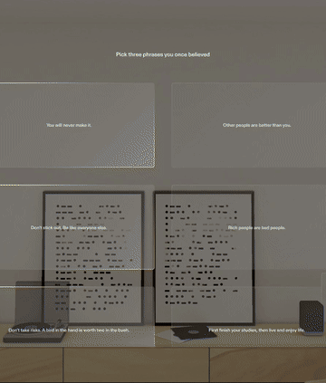
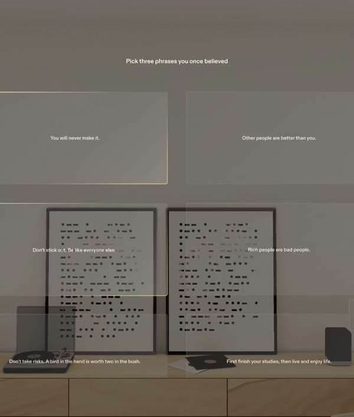
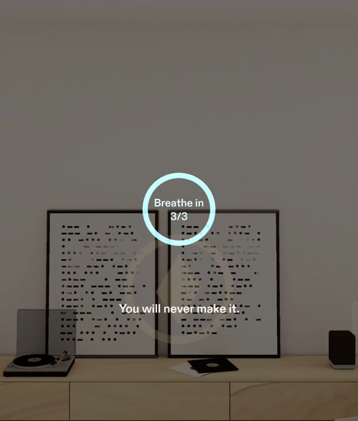
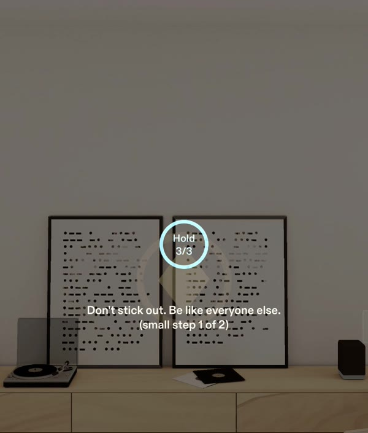
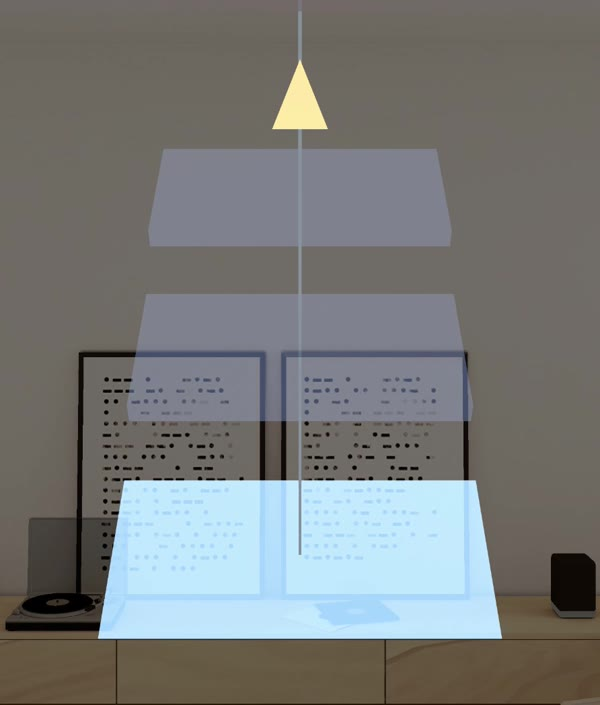
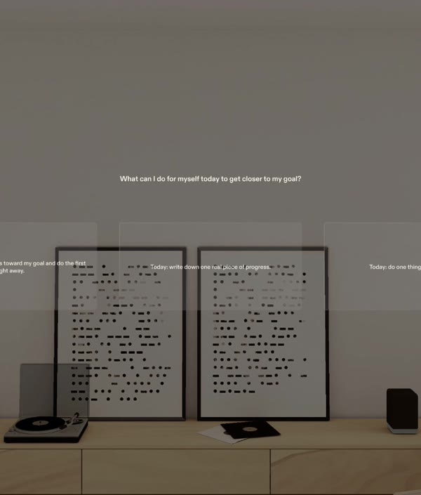
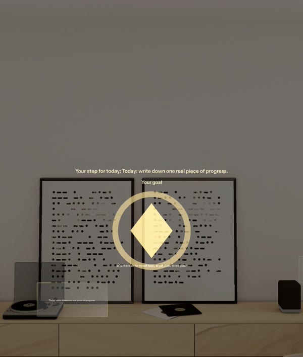

# Ladder Steps

**Stand at the bottom of your own ladder, breathe through the words that hold you back, and walk to your goal across your floor.** A Snap Spectacles Lens from the Ladder method.

*Lens Studio Interactive Preview. The three phrases you picked turn into steps that rise away from you toward your goal.*

Built for [Learn AR with SPECS](https://learn-specs.devpost.com/) on Devpost Learn, round 2 (November to December 2026). Planned with the Devpost Learn `plan-lens` skill ([devpost/design-brief.md](devpost/design-brief.md)), built by Claude Code through CLAD and the Lens Studio MCP, tested with LEAF. Runs in the Lens Studio preview; no Spectacles needed.

## See it in 30 seconds

- **Video:** [Watch on YouTube](https://youtu.be/CyNAvZhWhtY). One uncut take of the Lens Studio preview, driven by the `Demo walkthrough (video)` LEAF scenario.
- **In Lens Studio:** open `ladder-steps-lens.esproj`, choose the Spectacles device and Interactive Preview, and click three phrase tiles. A click is a pinch.
- **The moment to judge:** the ladder lying on your floor, your goal glowing at eye level at the far end, and one phrase at a time between you and it.

## Who it's for

People, most of them women, who know what they want but feel stuck between where they are now and where they want to be. Ladder Steps is one exercise from the Ladder method, made for glasses by the author of the method.

**Why glasses:** on a phone the ladder is a picture you scroll past. With Spectacles you stand in front of it in your own room, see your goal ahead of you and climb toward it with your hands and body free.

## How it works

1. **Pick three phrases.** Six large tiles hold phrases many people heard as children and believed, such as "You will never make it." You pinch the three that sound most like you.
2. **The ladder.** The tiles fly to the floor and become steps. "Me" is at the bottom, your goal glows at the far end at about eye level, and each step rises 8 cm so the whole path stays in the narrow view.
3. **Breathe.** On the current step only its phrase shows, 12 degrees below eye level, joined to its step by a thin line. A ring of light guides three rounds of box breathing (4 s in, hold, out, hold).
4. **Done or Not yet.** After the third round, Done makes the phrase crumble and wakes the next step. Not yet splits the step into two smaller ones, so you can slow down instead of forcing it. Done also works by stepping forward onto the next step.
5. **The goal.** When the last phrase is gone, the goal glows fully and asks: "What can I do for myself today to get closer to my goal?" You keep one of three cards.
6. **Memory.** Progress is saved on the device. Next time the ladder opens on the step where you stopped and names it: "You stopped at: ..."
7. **Return arrow.** If you turn away, a small arrow at the edge of the view points back to your current step.

## Run it

1. Install [Lens Studio](https://ar.snap.com/download) 5.23.2 or later.
2. Open `ladder-steps-lens.esproj`.
3. In the Preview panel choose the Spectacles device and Interactive mode. A click is a pinch; W, A, S, D move you, right drag looks around.
4. The preview has no real floor, so the ladder stands at a fixed height, 150 cm below the eyes. Change it in the Inspector: object `LadderSteps`, component `LadderMain`, `floorBelowEyes`.
5. The preview-only **Restart** button reopens the Lens and shows the "You stopped at" moment. Turn on `clearSavedOnStart` to begin from the tiles again.

Other settings on the same component: `breathPhaseSeconds` (4), `breathRounds` (3), `phraseGazeDown` (12 degrees), `goalDimWhileClimbing` (0.3), `showRestartButton` (on).

## Tests and evidence

Open the LEAF panel in Lens Studio and run any scenario, or all of them. All 9 pass in the preview, one at a time and back to back, last run on 12.11.2026 after the visual check.

| # | Done criterion from the brief | LEAF scenario | Status |
|---|---|---|---|
| 1 | Ladder lies ahead and rises, "Me" at the bottom, goal glowing at about 110 cm; current phrase 12 degrees below eye level, joined to its step by a line | `C1 ladder geometry` | Passed |
| 2 | Six tiles, pinch three, each highlights, they become the steps in the order chosen | `C2 pick three tiles` | Passed |
| 3 | The ring guides three breathing rounds; Done and Not yet show only after the third | `C3 breathing rounds` | Passed |
| 4 | Done makes the phrase crumble and wakes the next step | `C4 Done crumbles` | Passed |
| 5 | Not yet splits the step, so the ladder has one more step | `C5 Not yet splits` | Passed |
| 6 | After the last phrase the question and three cards show; one pinch keeps one card and fades two | `C6 goal cards` | Passed |
| 7 | Turning away shows an arrow that points back to the current step | `C7 return arrow` | Passed |
| 8 | Progress saved to persistent storage; after Restart the ladder opens where you stopped and names the step | `C8 persistent storage` | Passed |
| + | An IK hand reaches the tiles and Done | `IK reach tiles and Done` | Passed |

The tests found one real bug (the card you kept went dark), and it is fixed. No Lens code was changed to make a test pass. A tenth scenario, `Demo walkthrough (video)`, is not a test: it plays the whole Lens once at a watchable pace for the video.

The build is on record: 145 Lens Studio MCP calls, 8 build steps, 10 problems and their fixes, a design fix and a visual check in [build-log/BUILD-LOG.md](build-log/BUILD-LOG.md). Every prompt given to the agent is in [PROMPTS.md](PROMPTS.md).

## What is real and what is simulated

1. **Real:** the Lens. Everything in the video and the screenshots is the Lens running in Lens Studio's Interactive Preview, and the tests drive that same Lens.
2. **Simulated:** the floor. The preview has no floor, so the ladder stands 150 cm below the eyes. On Spectacles the design uses World Query to put it on your real floor.
3. **Simulated:** the room. The room behind the Lens is the Sunlit Room preview scene. It is not part of the Lens.
4. **Simulated:** the hand. In the video and the tests, pinches come from LEAF, not from a person.
5. **Sped up in the video:** breathing is 1.5 s and then 1 s per phase instead of 4 s, so the take fits under 3 minutes. The Lens default is 4 s.
6. **Logic proven** (tests and preview): the layout, picking 3 of 6 tiles, the breathing rounds, Done and Not yet, the goal cards, the return arrow, saving and reopening where you stopped, an IK hand reaching the buttons.
7. **Feel unproven** (needs real glasses): the Lens has never run on Spectacles. The ladder on a real floor, Done by a real step forward (in the code, not tested), real hand tracking, text readability on the additive display, comfort over time.

## Project layout

| File | What it does |
|---|---|
| `Assets/Scripts/LadderState.ts` | State, the six phrases, the question and cards, the Not yet split, save and load under the key `ladderSteps.v1` |
| `Assets/Scripts/LadderUI.ts` | Spectacles UI Kit buttons: the 6 tiles, Done and Not yet, the 3 cards, the preview-only Restart |
| `Assets/Scripts/LadderMain.ts` | The flow: pick, ladder, breathing ring, crumble, split, goal cards, return arrow, step forward, save and restore |
| `Assets/Scripts/Tests/` | LEAF scenarios `C1Geometry.ts` to `C8Storage.ts`, `IKReach.ts`, `DemoWalkthrough.ts`, helpers and `LeafIndex.ts` |
| `devpost/design-brief.md` | The approved brief from the `plan-lens` interview: the spatial moment, where things live in centimetres, 8 done criteria |
| `devpost/submission.md` | The Devpost project text |
| `build-log/BUILD-LOG.md` | Build steps, problems and fixes, design fix, visual check, MCP call counts, how the video was made |
| `PROMPTS.md` | Every prompt given to the agent |

## Built with

Lens Studio 5.23.2, Spectacles Interaction Kit 0.18.0, Spectacles UI Kit, LEAF 2.0.2, CLAD, Lens Studio MCP, Claude Code, Devpost Learn skill pack (`plan-lens`).

## Note

Ladder Steps is a self-reflection exercise from the Ladder method by its author, Aizhan Li. It is not therapy and does not replace working with a specialist.
